<picture>
  <source media="(prefers-color-scheme: dark)" srcset="assets/card-dark.svg">
  <source media="(prefers-color-scheme: light)" srcset="assets/card-light.svg">
  
</picture>

### `❯ whoami`

Desarrollador fullstack en Perú. Construyo aplicaciones web de punta a punta con **React / Next.js**, **Node.js** y **.NET**, y últimamente herramientas que integran **IA y automatización** en flujos reales de trabajo.

### `❯ ls ~/proyectos --destacados`

<!--featured:start-->
<!--featured:end-->

### `❯ cat ~/.config/stack.yml && linguist --top`

  <picture>
    <source media="(prefers-color-scheme: dark)" srcset="assets/stack-dark.svg">
    <source media="(prefers-color-scheme: light)" srcset="assets/stack-light.svg">
    
  </picture>
  <picture>
    <source media="(prefers-color-scheme: dark)" srcset="assets/languages-dark.svg">
    <source media="(prefers-color-scheme: light)" srcset="assets/languages-light.svg">
    
  </picture>

### `❯ git log --graph`

<picture>
  <source media="(prefers-color-scheme: dark)" srcset="assets/contributions-dark.svg">
  <source media="(prefers-color-scheme: light)" srcset="assets/contributions-light.svg">
  
</picture>

`❯ uptime` — este perfil se regenera solo cada día con GitHub Actions a partir de <a href="profile.yml">profile.yml</a>.
